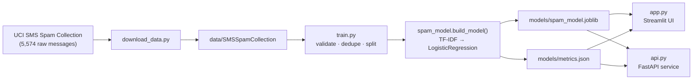

# 📩 SMS Spam Detector

An end-to-end spam-classification project: a scikit-learn NLP pipeline, a training/evaluation CLI, an interactive Streamlit demo, and a containerised FastAPI service — all covered by tests and CI.

[](https://github.com/BeFearless-cyberhead/spam-detector/actions/workflows/ci.yml)


**Held-out accuracy: 97.97%** · **Spam recall: 93.75%** · **Spam F1: 0.92**

---

## Highlights

- **Real NLP pipeline** — TF-IDF (unigrams + bigrams, sublinear TF, 30k features) feeding a class-balanced logistic-regression classifier.
- **Leak-free evaluation** — deduplicated dataset, stratified 80/20 split, and a saved `metrics.json` with confusion matrix, dataset SHA-256, and library versions for reproducibility.
- **Defensive data layer** — the loader rejects malformed rows, contradictory duplicate labels, and degenerate class splits instead of silently training on bad data.
- **Three interfaces, one model** — a Streamlit UI, a typed FastAPI REST service, and a CLI all import the same `spam_model.build_model()`.
- **Production-ish ergonomics** — input validation, lazy model loading, health/model-info endpoints, structured error responses (422/503), Dockerfile, docker-compose, Makefile, pre-commit hooks, and GitHub Actions CI.
- **60 tests** covering input validation, training, persistence, the HTTP contract, and a headless render of the Streamlit UI (`streamlit.testing.AppTest`).
---

## Results

Evaluated on a stratified 20% hold-out split (1,032 messages) of the UCI SMS Spam Collection.

| Class | Precision | Recall | F1 | Support |
| :--- | ---: | ---: | ---: | ---: |
| ham | 0.991 | 0.986 | **0.988** | 904 |
| spam | 0.902 | 0.938 | **0.920** | 128 |
| **accuracy** | | | **0.980** | 1,032 |

Confusion matrix (rows = actual, columns = predicted):

|  | pred. ham | pred. spam |
| :--- | ---: | ---: |
| **actual ham** | 891 | 13 |
| **actual spam** | 8 | 120 |

**How to read this:** a false positive (13 cases) means a legitimate message is flagged as spam; a false negative (8 cases) means spam slips through. Spam **recall** is the metric that matters most in a filtering product, which is exactly why the classifier uses `class_weight="balanced"` — it trades a little precision on the minority class for better coverage of spam.

Full metrics, dataset fingerprint, and training metadata: [`models/metrics.json`](models/metrics.json) · model card: [`docs/MODEL_CARD.md`](docs/MODEL_CARD.md)

---

## Architecture



**Inference path:** raw text → `validate_message()` (type, emptiness, 10k-char cap) → TF-IDF vector → logistic regression → `predict` (hard label) and `predict_proba` (spam confidence).

---

## Tech stack

| Layer | Tools |
| :--- | :--- |
| Language | Python 3.10+ (tested on 3.10 / 3.11 / 3.12) |
| ML / NLP | scikit-learn (`TfidfVectorizer`, `LogisticRegression`, `Pipeline`, `train_test_split`, metrics) |
| Data | pandas, UCI SMS Spam Collection |
| Persistence | joblib |
| Web UI | Streamlit |
| API | FastAPI, Pydantic v2, Uvicorn |
| Testing | pytest, pytest-cov, FastAPI `TestClient` |
| Quality | ruff (lint + format), pre-commit, GitHub Actions |
| Packaging / Ops | `pyproject.toml`, requirements files, Makefile, Docker, docker-compose |

---

## Quickstart

```bash
# 1. Clone and create an environment
git clone https://github.com/BeFearless-cyberhead/spam-detector.git
cd spam-detector
python -m venv .venv
.venv\Scripts\activate            # Windows
# source .venv/bin/activate       # macOS / Linux

# 2. Install dependencies
pip install -r requirements-dev.txt

# 3. Run the demos
streamlit run app.py                       # Streamlit UI on :8501
uvicorn api:app --reload --port 8000       # REST API on :8000 (docs at /docs)
```

A trained model is **committed** to `models/`, so both demos work immediately after install. To reproduce it from scratch:

```bash
python download_data.py    # fetch the UCI dataset into data/ (~1 MB zip)
python train.py            # retrain, overwrite models/*, print the report
# or simply: make data train
```

> The committed model was produced with scikit-learn 1.7.2. If your installed version differs, retrain (`python train.py`) so the artifact matches your environment.

---

## Usage

### Streamlit UI

```bash
streamlit run app.py
```

Paste a message and get a verdict with a confidence score; the sidebar shows the model card (accuracy, spam precision/recall, confusion matrix, dataset fingerprint, training date).

### REST API

```bash
uvicorn api:app --reload --port 8000
```

| Method | Endpoint | Purpose |
| :--- | :--- | :--- |
| `GET` | `/health` | Liveness + whether a model artifact is present |
| `GET` | `/model-info` | Stored evaluation metrics and metadata |
| `POST` | `/predict` | Classify one message |
| `GET` | `/docs` | Interactive OpenAPI (Swagger) documentation |

```bash
curl -X POST http://127.0.0.1:8000/predict \
  -H "Content-Type: application/json" \
  -d '{"message": "Congratulations! You have won a free prize, claim now."}'
```

```json
{
  "label": "spam",
  "is_spam": true,
  "spam_probability": 0.9134
}
```

Error contract: `422` for invalid/blank/oversized input, `503` when no model artifact is available.

### CLI / training

```bash
python train.py --help
python train.py --data samples/sample_messages.tsv --model-dir /tmp/out --test-size 0.3
```

| Flag | Default | Description |
| :--- | :--- | :--- |
| `--data` | `data/SMSSpamCollection` | Tab-separated `label<TAB>message` dataset |
| `--model-dir` | `models/` | Where the model and metrics are written |
| `--test-size` | `0.2` | Held-out fraction |
| `--seed` | `42` | Split random seed |

### Docker

```bash
docker compose up --build     # API on :8000, UI on :8501
# or just the API:
docker build -t spam-detector . && docker run -p 8000:8000 spam-detector
```

---

## Project structure

```
.
├── app.py                     # Streamlit demo UI
├── api.py                     # FastAPI service (create_app + endpoints)
├── spam_model.py              # Pipeline definition, validation, predict/load helpers
├── train.py                   # Training + evaluation CLI
├── download_data.py           # Dataset fetcher
├── conftest.py                # Makes the flat layout importable in pytest
├── pyproject.toml             # Metadata + ruff/pytest/coverage config
├── requirements*.txt          # Runtime / dev dependency pins
├── Makefile                   # Task shortcuts
├── Dockerfile · docker-compose.yml
├── .pre-commit-config.yaml · .github/workflows/ci.yml
├── docs/MODEL_CARD.md
├── samples/sample_messages.tsv  # 60-message smoke-test dataset
├── models/                    # Committed demo artifacts (model + metrics)
└── tests/                     # test_model.py · test_train.py · test_api.py · test_app.py
```

---

## Engineering notes

**Why TF-IDF + logistic regression?** On this dataset it reaches ~98% accuracy in seconds on a CPU, the coefficients are inspectable, and the whole artifact is 1.4 MB — a strong baseline that keeps the project dependency-light. A transformer would add hundreds of MB and GPU requirements for a marginal gain on SMS-length text.

**Data hygiene.** The raw UCI file has 5,574 lines; after dropping duplicates and blank rows, 5,160 unique messages remain. Any message that carries two different labels aborts training instead of silently picking one, and identical messages never appear in both the train and test splits — so the reported score is not inflated by leakage, a classic pitfall in spam-classification write-ups.

**Validation is shared, not duplicated.** `validate_message()` is used by the CLI, the UI, and the API, so the 10,000-character cap and non-empty rule cannot drift between interfaces.

**Lazy model loading.** The API starts even when no artifact exists and answers `/health` honestly (`model_loaded: false`), returning `503` on `/predict` instead of crashing on import — which keeps container health checks meaningful.

**Reproducibility.** Every training run records the dataset name, row count, SHA-256, Python version, scikit-learn version, and a UTC timestamp inside `metrics.json`.

---

## Development

```bash
make install     # pip install -r requirements-dev.txt
make lint        # ruff check . && ruff format --check .
make format      # ruff check --fix . && ruff format .
make test        # pytest -q
make coverage    # pytest --cov (terminal + HTML report in htmlcov/)
make data train  # download dataset, then retrain
make ui          # streamlit run app.py
make api         # uvicorn api:app --reload --port 8000
make docker      # docker compose up --build
make check       # lint + tests (what CI runs)
```

Hooks run the same gate locally:

```bash
pre-commit install
pre-commit run --all-files
```

CI (GitHub Actions) runs ruff, `ruff format --check`, and the full test suite with coverage on Python 3.10 and 3.12 for every push and pull request.

---

## Roadmap

- [ ] Calibrate probabilities (`CalibratedClassifierCV`) and report a Brier score
- [ ] Add character n-grams / hyperparameter search with cross-validated model selection
- [ ] Surface the most influential tokens per prediction (coefficient-based explainability)
- [ ] Batch prediction endpoint and a `/feedback` route to log misclassifications
- [ ] Drift monitoring on incoming message length and vocabulary
- [ ] Deploy the API to a public host and link a live demo

## License

MIT — see [LICENSE](LICENSE). The SMS Spam Collection dataset is distributed by the [UCI Machine Learning Repository](https://archive.ics.uci.edu/dataset/228/sms+spam+collection) under CC BY 4.0 and is downloaded at runtime rather than vendored.

---

> **Before you publish this repo:** the badge and `pyproject.toml` URLs assume a public GitHub repo named `spam-detector` under `BeFearless-cyberhead` — adjust if yours differs. Consider adding a screenshot of the Streamlit UI to `docs/` and linking it above the results table.
