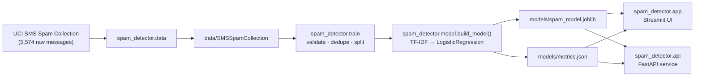

# 📩 SMS Spam Detector

An end-to-end spam-classification project: a scikit-learn NLP pipeline packaged as a proper Python library, a training/evaluation CLI, an interactive Streamlit demo, and a containerised FastAPI service — all covered by tests and CI.

[](https://github.com/BeFearless-cyberhead/Spam_detector/actions/workflows/ci.yml)


**Held-out accuracy: 98.84%** · **Spam precision/recall: 95.3%** · **Brier score: 0.0099**

---

## Highlights

- **A real package, not a folder of scripts** — `src/` layout, `pyproject.toml`, five console entry points, and typed public API (`from spam_detector import build_model`).
- **Real NLP pipeline** — TF-IDF (word + character n-grams, 30k features) feeding a class-balanced logistic-regression classifier, with cross-validated hyperparameter selection.
- **Calibrated confidence** — probabilities wrapped in `CalibratedClassifierCV` (sigmoid); the Brier score and log-loss are recorded in `metrics.json`.
- **Leak-free evaluation** — deduplicated dataset, stratified 80/20 split, and a saved `metrics.json` with confusion matrix, dataset SHA-256, and library versions for reproducibility.
- **Defensive data layer** — the loader rejects malformed rows, contradictory duplicate labels, and degenerate class splits instead of silently training on bad data.
- **Explainability** — coefficient-based top tokens per prediction (`--explain` in the CLI, `explain` flag in the API, panel in the UI).
- **Four interfaces, one model** — a Streamlit UI, a typed FastAPI REST service, and two CLIs all import `spam_detector.model.build_model()`.
- **Operations, not just demos** — batch prediction, a `/feedback` misclassification log, drift monitoring on length and out-of-vocabulary rate, tunable decision threshold, lazy model loading, structured error responses (422/503), Dockerfile, docker-compose, Makefile, pre-commit hooks, and GitHub Actions CI.
- **176 tests / 96% coverage** across validation, training, dataset extraction, the HTTP contract, the drift monitor, and headless Streamlit renders.

---

## Results

Evaluated on a stratified 20% hold-out split (1,032 messages) of the UCI SMS Spam Collection.

| Class | Precision | Recall | F1 | Support |
| :--- | ---: | ---: | ---: | ---: |
| ham | 0.993 | 0.993 | **0.993** | 904 |
| spam | 0.953 | 0.953 | **0.953** | 128 |
| **accuracy** | | | **0.988** | 1,032 |

Confusion matrix (rows = actual, columns = predicted):

|  | pred. ham | pred. spam |
| :--- | ---: | ---: |
| **actual ham** | 898 | 6 |
| **actual spam** | 6 | 122 |

**How to read this:** a false positive (6 cases) means a legitimate message is flagged as spam; a false negative (6 cases) means spam slips through. Spam **recall** is the metric that matters most in a filtering product, which is exactly why the classifier uses `class_weight="balanced"` — it trades a little precision on the minority class for better coverage of spam. Probabilities are sigmoid-calibrated (Brier score **0.0099**, log loss 0.0386), so the confidence numbers shown in the UI/API are honest.

Full metrics, dataset fingerprint, and training metadata: [`models/metrics.json`](models/metrics.json) · model card: [`docs/MODEL_CARD.md`](docs/MODEL_CARD.md)

---

## Architecture



**Inference path:** raw text → `validate_message()` (type, emptiness, 10k-char cap) → TF-IDF vector → logistic regression → sigmoid calibration → `predict_proba` (spam probability) → `threshold` decision (default 0.5, configurable).

---

## Tech stack

| Layer | Tools |
| :--- | :--- |
| Language | Python 3.10+ (tested on 3.10 / 3.11 / 3.12) |
| ML / NLP | scikit-learn (`TfidfVectorizer`, `LogisticRegression`, `CalibratedClassifierCV`, `Pipeline`, metrics) |
| Data | pandas, UCI SMS Spam Collection |
| Persistence | joblib |
| Web UI | Streamlit |
| API | FastAPI, Pydantic v2, Uvicorn |
| Testing | pytest, pytest-cov, FastAPI `TestClient`, `streamlit.testing.AppTest` |
| Quality | ruff (lint + format), pre-commit, GitHub Actions |
| Packaging / Ops | `pyproject.toml` (src layout, console scripts), Docker, docker-compose, Makefile |

---

## Quickstart

```bash
# 1. Clone and create an environment
git clone https://github.com/BeFearless-cyberhead/Spam_detector.git
cd Spam_detector
python -m venv .venv
.venv\Scripts\activate            # Windows
# source .venv/bin/activate       # macOS / Linux

# 2. Install the package with every extra (editable)
pip install --editable ".[all]"

# 3. Run the demos
spam-detector-ui                       # Streamlit UI on :8501
spam-detector-api                      # REST API on :8000 (docs at /docs)
```

A trained model is **committed** to `models/`, so both demos work immediately after install. To reproduce it from scratch:

```bash
spam-detector-data         # fetch the UCI dataset into data/ (or: python -m spam_detector.data)
spam-detector-train        # retrain, overwrite models/*, print the report
# or simply: make data train
```

> The committed model was produced with scikit-learn 1.7.2. If your installed version differs, retrain (`spam-detector-train`) so the artifact matches your environment.

### Console scripts

| Command | What it does |
| :--- | :--- |
| `spam-detector-data` | Download the dataset |
| `spam-detector-train` | Train and evaluate the model |
| `spam-detector-predict` | Classify one message from the command line |
| `spam-detector-api` | Serve the REST API (Uvicorn) |
| `spam-detector-ui` | Launch the Streamlit demo |

Every script also works without installation via `python -m spam_detector.<module>` as long as `src/` is on `PYTHONPATH`.

---

## Usage

### Streamlit UI

```bash
spam-detector-ui
# equivalent: python -m streamlit run src/spam_detector/app.py
```

Paste a message and get a verdict with a confidence score; the sidebar shows the model card (accuracy, spam precision/recall, confusion matrix, dataset fingerprint, training date).

### REST API

```bash
spam-detector-api                     # or: uvicorn spam_detector.api:app --reload
```

| Method | Endpoint | Purpose |
| :--- | :--- | :--- |
| `GET` | `/health` | Liveness + whether a model artifact is present |
| `GET` | `/model-info` | Stored evaluation metrics and metadata |
| `POST` | `/predict` | Classify one message (optional `explain`, per-request `threshold`) |
| `POST` | `/predict/batch` | Classify up to 100 messages, preserving order |
| `POST` | `/feedback` | Log a suspected misclassification to a JSONL file |
| `GET` | `/drift` | Input drift snapshot (length z-score, OOV rate) |
| `GET` | `/docs` | Interactive OpenAPI (Swagger) documentation |

```bash
curl -X POST http://127.0.0.1:8000/predict \
  -H "Content-Type: application/json" \
  -d '{"message": "Congratulations! You have won a free prize, claim now.", "explain": true}'
```

```json
{
  "label": "spam",
  "is_spam": true,
  "spam_probability": 0.953,
  "explanations": [
    {"token": "prize", "direction": "spam", "weight": 1.204}
  ]
}
```

Error contract: `422` for invalid/blank/oversized input, `503` when no model artifact is available.

### Training CLI

```bash
spam-detector-train --help
spam-detector-train --data samples/sample_messages.tsv --model-dir /tmp/out --test-size 0.3
# Opt-in: cross-validated hyperparameter search and calibration controls
spam-detector-train --search
```

| Flag | Default | Description |
| :--- | :--- | :--- |
| `--data` | `data/SMSSpamCollection` | Tab-separated `label<TAB>message` dataset |
| `--model-dir` | `models/` | Where the model and metrics are written |
| `--test-size` | `0.2` | Held-out fraction |
| `--seed` | `42` | Split random seed |
| `--threshold` | `0.5` | Spam probability threshold for reported metrics |
| `--search` | off | Stratified-CV hyperparameter selection (word/char n-grams, `C`) |
| `--cv` | `5` | Folds used by `--search` |
| `--no-calibrate` | — | Save the raw logistic regression instead of the calibrated one |
| `--no-char-ngrams` | — | Disable character n-grams |

Training records length/vocabulary statistics next to the model, which the `/drift` endpoint and UI sidebar compare live traffic against.

Override artifact locations without touching code: `SPAM_MODEL_PATH`, `SPAM_DATASET_PATH`, `SPAM_DATA_DIR`, `SPAM_THRESHOLD`, `SPAM_FEEDBACK_LOG`, `SPAM_DRIFT_WINDOW`, `API_HOST`, `API_PORT`.

### Docker

```bash
docker compose up --build     # API on :8000, UI on :8501
# or just the API:
docker build -t spam-detector . && docker run -p 8000:8000 spam-detector
```

### Live deployment (Render)

A [Blueprint](render.yaml) deploys both services from this repository — no code changes needed:

1. Push this repo to GitHub (done).
2. Go to [Render Dashboard](https://dashboard.render.com) → **New → Blueprint** → select the repo.
3. Render reads `render.yaml` and creates both services:
   - `spam-detector-api` — FastAPI at `https://spam-detector-api.onrender.com` (health-checked on `/health`)
   - `spam-detector-ui` — Streamlit at `https://spam-detector-ui.onrender.com`
4. URLs are `<service-name>.onrender.com` or come out of the blueprint creation screen.

Free-plan notes: both services are on the free plan, so they sleep after ~15 minutes of inactivity; the first request afterwards takes ~30–60 s to wake. The committed model artifact means no training happens at deploy time. Every push to `main` triggers a redeploy of both services.

---

## Project structure

```
.
├── src/spam_detector/
│   ├── __init__.py            # Public API surface + __version__
│   ├── config.py              # Paths, file names, env-var overrides
│   ├── model.py               # Pipeline, validation, predict/load helpers
│   ├── train.py               # Training + evaluation CLI
│   ├── data.py                # Dataset download and extraction
│   ├── app.py                 # Streamlit demo UI
│   ├── api.py                 # FastAPI service (create_app + endpoints)
│   ├── predict.py             # Single-message prediction CLI
│   ├── drift.py               # Rolling-window drift monitor
│   └── cli.py                 # Console-script launchers
├── tests/
│   ├── conftest.py            # Shared fitted-model fixtures
│   ├── test_model.py          # Validation, prediction, explainability
│   ├── test_train.py          # Data validation + end-to-end training
│   ├── test_data.py           # Archive extraction (no network)
│   ├── test_api.py            # HTTP contract and error semantics
│   ├── test_app.py            # Headless Streamlit renders (AppTest)
│   ├── test_drift.py          # DriftMonitor statistics and thresholds
│   ├── test_predict.py        # Prediction CLI
│   └── test_cli.py            # Launcher arguments
├── docs/MODEL_CARD.md         # Intended use, metrics, error analysis
├── samples/sample_messages.tsv  # 60-message smoke-test dataset
├── models/                    # Committed demo artifacts (model + metrics)
├── pyproject.toml             # Metadata, deps, entry points, tool config
├── requirements*.txt          # Runtime / dev dependency pins
├── Makefile · Dockerfile · docker-compose.yml
├── .pre-commit-config.yaml · .github/workflows/ci.yml
└── README.md · CONTRIBUTING.md · LICENSE
```

---

## Engineering notes

**Why a package layout?** The flat script layout grew into five modules that all needed each other's paths and a `sys.path` shim for tests. Moving to `src/spam_detector/` with `pyproject.toml` gives one import root, real entry points, installed-package behaviour identical to the repo, and a `config.py` that owns every path — the API, UI, CLI, and downloader can no longer disagree about where the model lives.

**Why TF-IDF + logistic regression?** On this dataset it reaches ~99% accuracy in seconds on a CPU, the coefficients are inspectable, and the whole calibration-wrapped artifact is under 4 MB — a strong baseline that keeps the project dependency-light. A transformer would add hundreds of MB and GPU requirements for a marginal gain on SMS-length text.

**Data hygiene.** The raw UCI file has 5,574 lines; after dropping duplicates and blank rows, 5,160 unique messages remain. Any message that carries two different labels aborts training instead of silently picking one, and identical messages never appear in both the train and test splits — so the reported score is not inflated by leakage, a classic pitfall in spam-classification write-ups.

**Validation is shared, not duplicated.** `validate_message()` is used by the CLI, the UI, and the API, so the 10,000-character cap and non-empty rule cannot drift between interfaces.

**Downloading is testable.** The fetcher is split into pure helpers (`fetch_archive`, `extract_dataset`), so the archive rules — exactly one matching member, size caps, no empty payloads — are covered by unit tests that never touch the network.

**Lazy model loading.** The API starts even when no artifact exists and answers `/health` honestly (`model_loaded: false`), returning `503` on `/predict` instead of crashing on import — which keeps container health checks meaningful.

**Reproducibility.** Every training run records the dataset name, row count, SHA-256, Python version, scikit-learn version, and a UTC timestamp inside `metrics.json`, alongside the calibration method, hyperparameter-search history, and the training-time length/vocabulary statistics that power drift monitoring.

**On coverage.** `coverage.py` cannot attribute line data to scripts that Streamlit compiles and `exec`s through its own loader, so the Streamlit entry point is excluded from the coverage total and verified behaviourally by

```bash
pytest tests/test_app.py -v      # renders the real app, asserts on the widget tree
```

---

## Development

```bash
make install     # pip install --editable ".[all]"
make lint        # ruff check . && ruff format --check .
make format      # ruff check --fix . && ruff format .
make test        # pytest -q
make coverage    # pytest --cov (terminal + HTML report in htmlcov/)
make data train  # download dataset, then retrain
make ui          # launch the Streamlit UI
make api         # launch the API with autoreload
make docker      # docker compose up --build
make check       # lint + tests (what CI runs)
```

Hooks run the same gate locally:

```bash
pre-commit install
pre-commit run --all-files
```

> `make` is optional convenience only (`winget install ezwinports.make` or `scoop install make` on Windows, `brew install make` on macOS). Every target maps 1:1 to a plain command, so you can always run `pip install --editable ".[all]"`, `ruff check .`, and `pytest -q` directly.

CI (GitHub Actions) installs the package, smoke-tests the entry points, runs ruff plus the full test suite with coverage on Python 3.10 and 3.12, and builds the Docker image to probe `/health` on every push and pull request.

---

## Roadmap

- [x] Calibrate probabilities (`CalibratedClassifierCV`) and report a Brier score
- [x] Add character n-grams / hyperparameter search with cross-validated model selection
- [x] Surface the most influential tokens per prediction (coefficient-based explainability)
- [x] Batch prediction endpoint and a `/feedback` route to log misclassifications
- [x] Drift monitoring on incoming message length and vocabulary
- [x] Deploy the API with a live demo link — [Render Blueprint](render.yaml) hosts the API and UI
- [ ] Publish to PyPI

## License

MIT — see [LICENSE](LICENSE). The SMS Spam Collection dataset is distributed by the [UCI Machine Learning Repository](https://archive.ics.uci.edu/dataset/228/sms+spam+collection) under CC BY 4.0 and is downloaded at runtime rather than vendored.

---

> **Before you publish this repo:** the badge and `pyproject.toml` URLs assume a public GitHub repo named `Spam_detector` under `BeFearless-cyberhead` — adjust if yours differs. Consider adding a screenshot of the Streamlit UI to `docs/` and linking it above the results table.
